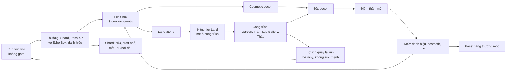

# Vòng lặp meta (Land) từ sơ đồ của Liam: brainstorm

Ngày 20/10/2026. Economy-designer. Chỉ là brainstorm, chưa chốt gì, chưa sửa GDD nào. Số trong doc là số thô, cần sim.

Nguồn đã đọc: sơ đồ Liam (stamina, building, decoration, defense, premium pass), `economy-v2.md` (Stone, Echo Box), `echobox-pass-v2.md`, `core-loop-v2.md` (luật C6, bảng tier Land), `depth-brainstorm-2026-10-20.md` trục 5, `depth-v3-design.md` §1-2, `Land.gd`, `MetaState.upgrade_land`, `land_tiers.json`.

## 0. Hiện trạng Land (để khỏi đề xuất trùng)

- Land là hub 3D, 6 tier theo biome: Savannah, Forest, Arctic, Mystic, Genesis, LunaLanding. Lên tier trả **Land Stone**: 40k / 100k / 180k / 500k / 1M (tổng 1,82M, `land_tiers.json`). Stone chủ yếu ra từ Echo Box (60% lượt hộp thường, ~78% lượt hộp mùa), một ít từ Nhiệm vụ và Pass. Heavy ~1 năm, regular ~2 năm tới LunaLanding.
- Công trình trên Land hiện là **cửa vào màn hình**, không sản xuất gì: Portal (Run), House (team preset), Weaponsmith (Nhiệm vụ), Alchemy (Echo Box), EquipmentStall (Pass), GemStorage (Vault), Jeweler (Store), Billboard (Leaderboard), Gallery (từ tier 5, đang là ô trống/mesh tạm; `LandNav` đã khai báo `Gallery.tscn` nhưng file chưa có, sub-text "Coming soon"). Trong `Land.gd`, `PLOTS` hiện chỉ có đúng 1 phần tử (gallery, min_tier 5); các nhà khác (Mastery Hall...) mở theo `min_tier` trong `houses.json`/bảng building, không qua PLOTS.
- Luật **C6**: Land không cho sức mạnh combat, chỉ cho bề rộng (cosmetic, tiện, lựa chọn trước run). Đã duyệt. `core-loop-v2` §6 còn **cắt hẳn**: building sản xuất, craft vật liệu, Land buff, premium pass, thêm currency thứ ba. Sơ đồ của Liam đảo lại một phần mấy cái này, nên mục 1 và câu hỏi có đánh dấu chỗ nào đụng C6.
- Tiền tệ đang có: Gene Shard (mềm, từ run), Land Stone (Land), Gem (trả tiền), vé Echo Box. Quy tắc dự án: **không thêm currency mới**.
- Cosmetic đã có: 223 món hộp thường (decor đất, decor nội thất, thú cưng, phụ kiện, tòa nhà, danh hiệu, dice/khung/FX), nhưng **chưa có chỗ người chơi đặt/bày** chúng lên Land (cần xác nhận lại với lane Land, tôi chỉ grep sơ).
- Còn có: Pass (free + trả tiền, tuần), Daily Mission, Titles, Vault (import Axie), Aid (mua trong run bằng Gem), Nhiệm vụ rủi ro. Chưa có: raid/PvP, sửa chữa, điểm thẩm mỹ, mốc theo Land.
- Chưa có phía server: không có dữ liệu Land của người khác, không có hàng đợi bất đồng bộ giữa người chơi. Leaderboard dùng replay-verify (`RunVerifier`), đó là nền tốt nhất để mượn.

## 1. Bảng ánh xạ ô sơ đồ -> Axie Dice

| Ô sơ đồ | Axie Dice đã có | Đề xuất | Ghi chú / lý do |
|---|---|---|---|
| Axie stamina (mua + tự hồi), Consume | Không có, và INV-7 cấm gate run | **Bỏ stamina cho run.** Xem 2 phương án ở mục 1.1 | INV-7: run thường không bị gate năng lượng/vé/cooldown. Stamina kiểu này đụng thẳng vào. |
| Gameplay (Social, Casino) | Run (Short/Full), Nhiệm vụ, Ascension | Run là gameplay duy nhất cần; Nhiệm vụ/Ascension giữ vai "nội dung mở rộng" | Không thêm mini-game kiểu Casino (Echo Box đã là phần may rủi, đừng thêm nguồn thứ hai). |
| Reward: More stamina | Không | **Bỏ** (hoặc đổi thành "công thợ", xem 1.1 phương án B) | |
| Reward: Gold | Gene Shard (từ run), Land Stone (hộp, Pass) | **Gold = Land Stone** cho thứ gì thuộc Land; Shard cho đồ nhỏ | Không thêm currency. Chi tiết mục 4. |
| Reward: Account/NFT progression | Pass XP, titles, Vault Axie, Ascension | Đã có. Thêm Mastery theo Axie (cosmetic) sau, từ depth-brainstorm 5b | Không cần ô mới. |
| Reward: Attack/Defense items | Relic/Lõi (trong run), Aid | **Không có "đồ" mang ra ngoài run** (C6). Phần phòng thủ Land dùng đội + Lõi dựng riêng, mục 3 | Đồ tấn công/phòng thủ vĩnh viễn = sức mạnh ngoài run, phá C6/INV-6. |
| Reward: Collection Card | Cosmetic Echo Box, Mastery, mảnh mùa | Đã có: cosmetic chính là "card". Không thêm loại thẻ mới | Thẻ trùng đổi Stone nhỏ (đã chốt ở core-loop-v2). |
| Upgrade main structure (tăng trần + stamina miễn phí) | `upgrade_land` = tier 1..6, trả Stone | **Giữ.** Tier tăng "trần" thành: số ô công trình, số slot bày decor, cấp tối đa của công trình, mức đội phòng thủ | Đã là cơ chế gốc. Mới chỉ mở biome + Gallery; cần thêm thứ tier thực sự mở. |
| Open Inns (mở nội dung, mở chỗ) | Không | **Thay bằng "Ô công trình"** (building plot) mở theo tier. Xem 1.2 | Gallery/PLOTS đã là mẫu: ô trống hiện ra, trả Stone, dựng. |
| Place & upgrade more structures | 9 công trình cố định, không nâng cấp độc lập | Thêm công trình mới trên ô trống; nâng cấp lv 1-4 theo tier (mesh `*_lv%d` đã có) | Mesh lv1-4 đã có sẵn trong asset HomeLand. |
| Structure utility: Decoration | Cosmetic decor chưa có chỗ đặt | **Thêm** khu đặt decor (Garden / Gallery) | Đây là ô mới đáng làm nhất. |
| Structure utility: Farming materials, crafting gears | Không | **Bỏ** | Bị cắt ở core-loop-v2 (craft vật liệu). Thêm thì phải có currency/nguyên liệu mới và sức mạnh gear = C6. |
| War utility: Tower defense, buff | Không | Tower = **Lõi/affix của đội phòng thủ** (mục 3). Buff = **bỏ** (Land buff bị cắt) | |
| War utility: Save gold, Axie | Vault giữ Axie (import) | **Két Stone** (giữ Stone khỏi bị cướp, có trần) nếu làm raid | Chỉ cần nếu có raid. |
| Repair destroyed structure | Không | **Thay bằng sửa bằng Shard**, chỉ khi có raid. Hạ cấp "hư" chỉ là hiệu ứng thẩm mỹ, không khoá công trình | Đừng để Land bị phá khoá việc chơi (INV-7 tinh thần). Xem mục 3. |
| Materials in Gold Shop | Store (Jeweler) bán cosmetic, Aid | Không thêm "vật liệu". Decor mua thẳng bằng Stone/Shard ở Store, hoặc quay Echo Box | |
| Craft/Collect | Echo Box (quay), đổi mảnh mùa | Giữ Echo Box làm đường "collect". Craft = **đổi thẻ trùng + Shard lấy món chỉ định** (có trần/tuần) | Cho người không may một đường chắc chắn (đã có pity). Không thêm nguyên liệu. |
| Decoration items (Sink) | 223 món hộp, chưa có chỗ dùng | Đặt vào ô decor, mỗi món có "điểm thẩm mỹ" theo độ hiếm | Thêm lý do để món cosmetic có giá trị sử dụng ngoài sưu tầm. |
| Aesthetic Points | Không | **Thêm.** = tổng điểm decor đã đặt + công trình + danh hiệu. Hiện ở profile | Điểm là con số tính ra, không phải currency (không tiêu được). |
| Unlock Milestone (thêm stamina) | Pass level, titles, mốc Gallery | Mốc theo Aesthetic Points trả **cosmetic/danh hiệu/vé Echo Box nhỏ**, không phải stamina | Vé thêm vào faucet vé cần sim (mục 4). |
| Purchase premium pass | Pass trả tiền (Gem) đã có | **Giữ nguyên.** Không thêm SKU. Mốc Aesthetic Points có thể là hàng thứ ba của Pass sau | Token bAXS/AXS/USDC: chỉ ghi là hướng tương lai, chưa làm. |
| bAXS <> AXS, USDC | Không | **Không làm.** Ghi "tương lai" | Theo ràng buộc playtest. |
| Random attack, Destroy structure, Steal gold | Không | Xem mục 3 | Có làm hay không là quyết định lớn nhất của doc này. |
| Gold quay lại vòng (Steal gold -> Gold) | | Có trần cướp, mục 3/4 | |

### 1.1 Stamina: hai phương án thay

**Phương án A (khuyến nghị): bỏ hẳn, nhịp ngày đến từ nơi khác.**
Không có năng lượng. Run không gate (INV-7 giữ sạch). "Lý do quay lại mỗi ngày" lấy từ: Daily Mission (đã có), Echo Box vé miễn phí mỗi ngày (đã có), thu hoạch công trình theo giờ (mục 2: Garden/Trạm thu Stone nhỏ, tích tới trần ~24h, không phạt nếu quên), và lượt raid theo ngày (đếm số lần, không phải currency).
- Ưu: không đụng INV-7, không thêm field gate, ít UI, không gây cảm giác "bị chặn" (hợp hướng "khó rồi bán giải pháp": ta bán giải pháp trong run (Aid), không bán quyền được chơi).
- Nhược: mất công cụ ép nhịp cổ điển. Dựa vào thu hoạch + daily để giữ nhịp; nếu D1/D7 thấp thì thiếu đòn bẩy.

**Phương án B: "Công thợ" chỉ gate việc của Land, không gate run.**
Mỗi ngày N lượt "công thợ" dùng để nâng cấp/sửa/đặt công trình lớn và để raid (hồi tự động, cap 3-5). Không đụng run.
- Ưu: có nhịp kiểu stamina mà INV-7 vẫn nguyên. Hợp Liam: "thay bằng cái khác".
- Nhược: thêm một bộ đếm, và nếu mua được bằng Gem thì thành "bán thời gian" cho thứ chẳng ai thiết (nâng cấp Land vốn đã mất cả năm). Mua công thợ để lên tier nhanh nghe như bán tiến độ Stone chứ không phải giải pháp. Rủi ro: lặp lại sai lầm "currency thứ ba" nếu hiện ra như tài nguyên.
Nếu chọn B: **chỉ là bộ đếm lượt/ngày, không phải tiền**, không bán, hồi 00:00 UTC (cùng mốc `gem_claim_next_utc`).

### 1.2 Inns: thay bằng gì

| Lựa chọn | Mô tả | Hợp game? |
|---|---|---|
| **Ô công trình mở theo tier (khuyến nghị)** | Mỗi tier Land mở thêm 1-2 ô trống (như `PLOTS` Gallery) để xây Garden, Trạm Lõi, Tháp... | Rất hợp: dùng đúng cơ chế đã có, Stone vốn đã là sink. |
| Mở thêm biome | Đã làm (tier = biome). Chỉ nên gắn thêm nội dung biome (decor riêng) | Hợp, không cần việc mới. |
| Chế độ chơi mới theo tier | Ví dụ tier 3 mở Full, tier 4 mở Nhiệm vụ cao | Lệch: Full/Nhiệm vụ đã gate bằng Ascension. Không gate chế độ bằng Land (INV-7). |
| Inn thật (nơi ở của Axie) | Nghỉ ngơi/hồi | Bỏ: không có Axie HP ngoài run. |

## 2. Vòng lặp đề xuất cho Axie Dice

Nguyên tắc: **sức mạnh vẫn chỉ nằm trong run** (C6, INV-6). Land cho **bề rộng và lựa chọn** quay lại run, không cho cộng số.

Danh sách mũi tên cho dễ đọc:
1. Run -> Shard, Pass XP, vé Echo Box (đã có).
2. Vé -> Echo Box -> Land Stone hoặc cosmetic (đã có).
3. Stone -> nâng tier Land -> mở **ô công trình** và slot decor (mới: mở thực chất).
4. Công trình -> lợi ích quay lại run, kiểu **bề rộng** (đề xuất, mục 2.1).
5. Cosmetic decor -> đặt lên Land -> **Điểm thẩm mỹ** (mới).
6. Điểm thẩm mỹ -> mốc -> danh hiệu / cosmetic / vé nhỏ -> (vòng lại Echo Box).
7. Mốc cũng là một hàng của Pass (không thêm SKU).
8. (Tuỳ chọn, mục 3) Đội phòng thủ Land -> raid -> Stone có trần / thưởng cosmetic -> vòng lại bước 3.

### 2.1 Công trình cho lợi ích quay lại run (sạch với C6)

Phân loại theo mức đụng C6:

| Mức | Ví dụ | C6 |
|---|---|---|
| Sạch (đề xuất làm) | **Trạm Lõi** (Core Station): mở thêm Lõi vào pool bốc theo tier hoặc "Lõi yêu thích" (đánh dấu 1-2 Lõi muốn thấy sớm, không tăng xác suất, chỉ cho xem trước pool). **Kệ Luật run**: mở thêm Luật run để chọn ở lượt 2 (2b của depth-v3 đang rút 1 trong 2). **Garden**: thu hoạch Stone/Shard nhỏ theo giờ. **Gallery**: khung vinh danh, xem Land người khác. Part/skin/dice cosmetic mở theo tier. | Bề rộng, không cộng sức mạnh |
| Xám (cần Liam duyệt) | **Thêm 1 lần reroll Lõi**, **thêm 1 lựa chọn ở lần Lõi đầu (4 thẻ thay 3)**, Lõi khởi đầu "miễn phí" ở bậc Rêu | Là sức mạnh nhỏ vĩnh viễn: đúng thứ F5b/C6 đã cắt khỏi Pass. Lần 1 có 4 thẻ khi mở perk relic khởi đầu đã chốt 20/10, nên có tiền lệ, nhưng vẫn cần xét cùng ranked (Aid bán trong ranked, hướng 11/10). |
| Đỏ (không đề xuất) | HP/dmg cộng vĩnh viễn, tháp buff đội | Phá C6 và INV-6 |

Khuyến nghị: làm hàng "Sạch", để 1 món xám (Lõi khởi đầu cố định có thể chọn) vào câu hỏi cho Liam, không tự đưa vào.

### 2.2 Cái gì kéo người chơi quay lại mỗi ngày, cái gì kéo nhiều tuần

| Nhịp | Cơ chế | Đã có / mới |
|---|---|---|
| Mỗi ngày (vài phút) | Daily Mission, vé Echo Box miễn phí, quà Gem hằng ngày, **thu hoạch Garden** (tích tối đa 24h, không phạt quên), (tuỳ chọn) lượt raid/ngày | Daily + vé + Gem có; Garden và raid mới |
| Mỗi tuần | Việc tuần Pass, tuần Daily, Nhiệm vụ rủi ro, mốc điểm thẩm mỹ nhỏ | Pass có; mốc thẩm mỹ mới |
| Nhiều tuần | Nâng tier Land (heavy 1 năm), Mastery Axie, mùa Echo Box 12 tuần, hoàn thiện bộ decor/biome, Ascension | Hầu hết đã có |
| Mục tiêu "nhìn thấy" | Land của mình đẹp lên khi chơi (decor, biome đổi), có người ghé Gallery | Mới, đây là phần Land hiện thiếu nhất |

Nhận xét: phần "nhiều tuần" đã dày (Stone 1,8M). Thiếu phần **Land phản hồi lại việc chơi ngay trong ngày** và **chỗ dùng cosmetic**. Điểm thẩm mỹ + Garden lấp đúng hai chỗ đó.

> **Reviewer:** nhận xét trên đúng một nửa. (a) Garden 20-50 Stone + 10-20 Shard/ngày (§4.3) là quá nhỏ để thành lý do mở game: Daily/vé Echo Box mới là thứ kéo, Garden chỉ là thêm một việc bấm. Nó chỉ có sức kéo nếu có **thứ để chờ và thấy**: vd. Garden/Trạm ra một "gói quà" cosmetic nhỏ hoặc mảnh decor (không chỉ Stone) và Land đổi trạng thái nhìn thấy được (ra hoa, có Axie đứng chơi). (b) Vòng lặp hiện **không đẩy ngược về run**: mũi tên "bề rộng -> RUN" (§2 đồ thị) chỉ có Trạm Lõi/Kệ Luật, mà cả hai chưa tồn tại tới khi depth v3 xong. Trong lúc đó Land là vòng sưu tầm khép kín (decor -> điểm -> mốc -> vé) không liên quan gì tới việc chơi run. Để nối với depth v3 chặt hơn, xem 2.3 mục D.

### 2.3 Phương án gần sơ đồ hơn (reviewer thêm, không thay khuyến nghị ở trên)

Bản gốc cắt gần hết chỗ sơ đồ đụng C6 hoặc core-loop-v2. Lý do C6/INV-6 là đủ mạnh cho **ranked** (Aid đã tính trong ranked, hướng bán giải pháp). Nhưng nhiều chỗ cắt dựa vào "core-loop-v2 đã cắt", mà đó là quyết định của chính bản đề xuất đó và Liam là người vừa gửi sơ đồ ngược lại. Với từng chỗ, một phương án gần sơ đồ để Liam chọn:

| Chỗ bị cắt/làm nhẹ | Khuyến nghị gốc | Phương án gần sơ đồ | Giá phải trả |
|---|---|---|---|
| A. Đồ công/thủ, Land buff, tháp buff | Cắt hẳn (C6) | **Buff Land chỉ bật ở chế độ thường/Nhiệm vụ, tắt ở Ranked** (như cách `run_bonuses` từng tách ranked). Nhỏ, có trần, kiểu "Tháp Canh: +1 reroll đầu run thường". | Phá C6 cho chế độ thường. Mâu thuẫn với B3 (12/10: unlock tính cả trong ranked), nên phải duyệt lại B3. Đụng `run_bonuses` = bump `RULES_VERSION`. |
| B. Craft / farming / gear | Cắt (đã cắt ở core-loop-v2) | **Xưởng**: nguyên liệu = thẻ trùng + Shard, ra decor/cosmetic theo công thức chọn trước (không loại vật liệu mới, không currency mới). Lưu ý bảng tiền tệ của core-loop-v2 vẫn ghi sẵn "craft decor" là sink Shard và có Fuse 3 trùng, nên bản gốc nói "bị cắt" là quá tay: đúng là chỉ cắt craft **vật liệu**. | Thêm UI công thức; cần sim thẻ trùng để Xưởng không thay Echo Box. |
| C. Stamina | Bỏ (A) | Phương án B "công thợ" đã có trong 1.1. Gần sơ đồ nhất: công thợ hồi theo giờ, **không bán**, dùng cho nâng/xây/raid. | Một bộ đếm nữa; chỉ là nhịp, không ép. |
| D. Công trình có tiện ích quay lại run | Trạm Lõi + Kệ Luật (cần depth v3) | **Gắn biome/công trình vào Lõi & Luật run ngay khi depth v3 ra**: mỗi tier Land mở thêm 1 "thẻ Luật run ứng viên" và 1-2 Lõi chỉ xuất hiện trong pool của người đã xây công trình đó (bề rộng, không sức mạnh); Lõi mới thuộc biome nào thì hiện trên Land biome đó. Cho Land có "bộ mặt" trong build, và người chơi muốn lên tier vì muốn Lõi/Luật chứ không chỉ vì decor. | Phải xem xét lại 2.10 depth v3 (pool Lõi "chỉ đánh") để khoá một số Lõi sau Land tier có làm lệch cân bằng không; INV-7 không vi phạm vì không gate run. |
| E. Raid cướp tài nguyên | Hoãn R2; làm R1 ghost | **R2-Shard**: cướp Shard (không phải Stone) từ Két, trần cứng, chỉ ghép ngang tier, bảo vệ người mới. Đã nhắc ở §3 nhưng chỉ như phương án phụ; thành lựa chọn chính nếu Liam muốn "mất mát thật". | Cần server nhiều (Két, matchmaking, chống farm). Shard cũng là tiền chảy cần cân. Không nên làm khi chưa có người chơi thật. |
| F. Tháp phòng thủ | R3 sau depth v3 | Gộp R1+R3: ghost đã mang **1 Lõi "tháp"** ngay từ đầu (dữ liệu sẵn, thêm Lõi vào đội phòng thủ khi depth v3 ổn). | Cần AI đội phòng thủ biết dùng Lõi. |

Ghi chú: A là chỗ duy nhất đụng luật đã duyệt; B-F không đụng C6.

## 3. Phòng thủ Land kiểu xúc xắc

Điều cần chốt trước: sơ đồ có "Random attack -> Destroy -> Steal gold". Với game xúc xắc có roll server, **không cần đánh thật giữa hai người online**; có thể là đánh bất đồng bộ với đội "bóng" (ghost). Dưới đây là 3 phương án, từ nhẹ tới nặng.

### Phương án R1: Ghost leaderboard + "Land Challenge" (không cướp gì) — nhẹ nhất
Người chơi đặt một **đội phòng thủ** (5 Axie từ team preset + 1-2 Lõi được chọn làm "tháp"). Người khác (hoặc AI-bot lấp chỗ) chạy một **trận phòng thủ ngắn** (1 combat) chống lại đội đó, quyết định bằng seed do server cấp và replay-verify như Leaderboard. Thắng/thua chỉ cho **huy hiệu, điểm Gallery, một ít Shard/vé cho người đánh**. Không ai mất gì.
- Vì sao hợp: dùng `RunVerifier` + deterministic combat sẵn có; server chỉ lưu "đội + seed + kết quả"; người đánh có thể bị AI thay khi hàng đợi thưa.
- Rủi ro: ít sâu hơn sơ đồ, thiếu "căng thẳng mất mát". Phải cân đội phòng thủ vì combat có cả hold/mana/hàng (đội phòng thủ do AI điều khiển hay ghi lại action? Phải AI vì người dùng không có mặt: cần AI đủ tốt để không bị người chơi bơm bẩn).
- Cần server: có (lưu đội, cấp seed, ghi kết quả). Không cần Worker mới lớn, chỉ vài endpoint trong `worker/src/`.

### Phương án R2: Raid có trần cướp Stone (đúng sơ đồ, thu nhỏ)
Như R1 nhưng thắng thì cướp **Stone trong Két** của chủ Land (không phải ví). Két do công trình "Kho" tự đầy theo giờ (Garden xả vào), trần mỗi két nhỏ (thô: ≤ 1-2% giá nâng tier kế, ≤ 3 lần bị cướp/ngày, cướp được tối đa 30% két, người cướp mỗi ngày cướp ≤ N lần). "Công trình bị phá" chỉ là **trạng thái thẩm mỹ + khoá Két tạm** (không khoá chức năng khác), sửa bằng Shard. Thắng phòng thủ thì chủ nhận thưởng nhỏ.
- Vì sao hợp: có bồi hồi mất/được, có sink Shard, có lý do đầu tư công trình.
- Rủi ro:
  - **Người mới bị cướp nản.** Cần: bảo vệ 7 ngày/đến tier 2, người mới chỉ gặp người ngang tier/ngang tuổi, két mới trống nên chẳng có gì để cướp.
  - **Stone là currency có giá trị cao** (Echo Box, 1 năm tới tier cuối) nên cướp Stone gây lạm phát/ảnh hưởng thang thời gian đã Liam chấp nhận. Giải pháp: Stone cướp được là Stone **sinh ra từ Két**, không trừ khỏi ví; tức là tạo ra thêm Stone nhỏ cho người cướp và người bị cướp mất phần Két chưa thu thôi. Vì vậy tổng Stone trong hệ **tăng**, cần giảm ở nguồn khác hoặc để ở mức rất nhỏ.
  - Kiếm Stone bằng raid kiểu farm: người chơi cày raid thay Echo Box. Cần trần cứng/ngày.
  - Cần server nhiều hơn R1: trạng thái Két, hàng đợi, chống gian lận, xử lý đồng thời.
  - Dễ trượt sang cảm giác "trò kiếm tiền", mâu thuẫn hướng "chưa đưa tiền thật vào sâu" nếu Stone sau này gắn token.

### Phương án R3: Tower = Lõi/affix, đánh theo mùa (nặng nhất)
Đội phòng thủ được dựng như một **run mini**: chủ Land chọn 2-3 Lõi/affix làm "tháp" (từ pool Lõi của depth v3, ví dụ "Thành Trì", "Gấp") + 1 Luật run; kẻ tấn công phải thắng 2-3 trận liên tiếp trong **sân phòng thủ** đó. Có mùa (tuần), có bảng xếp hạng Land Defense, thưởng cosmetic mùa. Không cướp Stone, chỉ cướp "danh vọng" (điểm Gallery).
- Vì sao hợp: dùng đúng hệ Lõi mới như yếu tố chiến thuật, xúc xắc có thể xem replay, tạo nội dung cộng đồng (xem cách người khác dựng).
- Rủi ro: phụ thuộc depth v3 (Lõi, Luật run) xong và ổn định; cần cân bằng sân phòng thủ (một Lõi quá mạnh thành meta cứng); khối lượng lớn; mỗi Lõi mới phải test cho cả chế độ phòng thủ.

Khuyến nghị: **R1 trước** (ghost + huy hiệu, không cướp), thiết kế dữ liệu để sau nâng lên R3 (dùng Lõi làm tháp). **R2 (cướp Stone) hoãn**, ít nhất tới khi Stone ổn và đã xong sim; lý do: Stone là currency lõi của năm đầu, cướp nó đụng thang thời gian đã duyệt và dễ nản người mới. Nếu Liam muốn "mất mát" thì thử **cướp Shard** (currency mềm, đã có vấn đề tích dư) với trần nhỏ.

## 4. Kinh tế

### 4.1 Nguồn vào (faucet) / nguồn ra (sink)

| Tiền | Vào | Ra |
|---|---|---|
| **Land Stone** | Echo Box (chính), Nhiệm vụ, Pass, thẻ trùng đổi Stone nhỏ; **mới**: mốc Aesthetic Points (nhỏ), Garden (nhỏ) | Nâng tier Land (có sẵn, 1,82M); **mới**: xây ô công trình mới và nâng lv công trình; (R2) Két |
| **Gene Shard** | Run, Pass | Unlock/Echo mảnh mùa, Store; **mới**: đặt decor (phí nhỏ), sửa công trình (nếu có raid), craft/đổi thẻ trùng lấy món chỉ định |
| **Gem** (trả tiền) | Quà ngày, mua | Aid, Store, Pass; **không thêm sink mới** ở doc này |
| **Vé Echo Box** | Daily, Pass, bundle, **mới**: mốc thẩm mỹ | Echo Box |
| **Điểm thẩm mỹ** | Tính ra từ decor + công trình + title | Không tiêu được (không phải currency) |

### 4.2 Chỗ có thể lạm phát / xấu

1. **Stone từ nguồn mới** (Garden, mốc thẩm mỹ, raid). Thang thời gian 1 năm/2 năm đã được Liam chấp nhận trên số hiện tại; thêm faucet Stone là rút ngắn nó. Đề xuất: faucet mới chỉ trả **dưới ~3-5% tổng thu Stone của regular/tuần** (cần sim), hoặc trả cosmetic/vé thay vì Stone.
2. **Vé từ mốc thẩm mỹ** là faucet vé -> Stone gián tiếp (mỗi vé hộp thường ~242 Stone kỳ vọng). Mốc nên trả danh hiệu/cosmetic nhiều hơn vé.
3. **Decor bị "khoá giá trị"**: decor đặt rồi không tiêu hao, nên nếu không có sink thường xuyên thì Shard/Stone dồn lại. Sink hợp lý: phí đặt/đổi decor rất nhỏ (Shard), nâng lv công trình (Stone), sửa chữa (Shard nếu có raid). Không sink kiểu "decor hỏng/hết hạn" (cảm giác phạt).
4. **Pass + mốc thẩm mỹ chồng thưởng** làm Stone/vé tăng nhanh cho người trả tiền. Giữ nguyên nguyên tắc bundle: chấp nhận nhưng đo.
5. **Raid farm** (R2): người cày ghost thay Echo Box. Trần ngày cứng.
6. **Thiếu sink Shard** đã được ghi từ trước ("chống tích Shard vô ích", core-loop-v2). Decor + sửa + craft nhỏ là chỗ dùng tự nhiên.

### 4.3 Số khởi điểm thô (cần sim, đừng chốt)

| Hạng mục | Số gợi ý | Căn cứ |
|---|---|---|
| Ô công trình mới | +1 ô ở tier 2, 3, 4, 5 (Gallery đã ở tier 5) | Tier 2-5 là các bậc 40k-500k Stone |
| Giá xây công trình | 5-10% giá tier kế (vd. tier 2->3: 5.000-10.000 Stone) | Không thay đổi thang năm tới LunaLanding quá ~5% |
| Nâng lv công trình | 10k / 25k / 60k Stone (lv2/3/4) | Mesh lv1-4 có sẵn |
| Garden (thu hoạch) | 20-50 Stone + 10-20 Shard / ngày ở lv1, tối đa gấp 2 ở lv4 | ≈ 0,1 vé Echo Box/ngày, vẫn nhỏ so với 242 Stone/vé |
| Phí đặt decor | 5-30 Shard theo độ hiếm, trả lại 100% khi gỡ (tránh phạt chơi thử) | |
| Điểm thẩm mỹ mỗi món | Common 1, Rare 3, Epic 8, Legendary 20, Mythic 50 (xấp xỉ gấp 2,5 mỗi bậc) | Khớp tỉ lệ độ hiếm Echo Box |
| Mốc thẩm mỹ | ~8 mốc, trả cosmetic/danh hiệu, tối đa vài vé | Cần sim bằng số món trung bình người chơi có |
| Sửa công trình (R2) | 50-200 Shard | Đủ thành sink, không thành chặn |
| Két Stone (R2) | Trần 1-2% giá tier kế | |

Cần sim: Stone tổng/tuần theo casual/regular/heavy khi thêm Garden và mốc; số decor người chơi có theo tuần (từ bảng Echo Box); phân bố điểm thẩm mỹ để mốc không rơi hết vào người trả tiền; tác động lên "tuần tới LunaLanding" ở `economy-v2.md` §6.4 (phải không đổi quá ~2-3%).

## 5. Ba gói

Ước lượng công theo ngày-người (thô). "Server" = cần Worker/D1.

| Gói | Nội dung | Công | Phụ thuộc | Server |
|---|---|---|---|---|
| **Nhỏ: "Land có việc để làm"** | Mở thực chất theo tier (1-2 ô công trình mới/tier, nâng lv công trình bằng Stone); **Garden** (thu hoạch theo giờ); **Aesthetic Points** hiển thị trên profile (tính ra từ cosmetic đang sở hữu, chưa cần đặt); mốc điểm thẩm mỹ trả danh hiệu/cosmetic. Không stamina, không raid. | ~6-9 | Cần có chỗ hiển thị cosmetic đã sở hữu; sim Stone | Ít: Garden tích tối đa 24h có thể làm client + `SaveStore` rồi gắn server khi cần chặn gian lận đồng hồ (Echo Box đã online-only nên làm luôn qua Worker). Field mới vào `MetaState.reload_from_store()` |
| **Vừa: "Decor + Trạm Lõi + Ghost thử"** | Gói nhỏ + **chế độ đặt decor** (kéo thả trong Land, slot theo tier, lưu vị trí), **Trạm Lõi / Kệ Luật run** (bề rộng cho run, hàng "Sạch"), **R1 ghost**: đặt đội phòng thủ, người khác đánh bằng seed server, thưởng huy hiệu/Gallery. Mốc thẩm mỹ thành hàng của Pass. | ~18-28 | Hệ Lõi/Luật run của depth v3 xong (Trạm Lõi cần Lõi thật); UI decor đặt/gỡ; Gallery thật; `RunVerifier` mở rộng cho trận phòng thủ | Có: lưu đội phòng thủ, cấp seed, ghi kết quả, hàng đợi/AI thế chỗ, `RULES_VERSION` bump |
| **Lớn: "Vòng đủ"** | Gói vừa + **R2 Két + cướp có trần** hoặc **R3 tháp Lõi theo mùa**, sửa chữa bằng Shard, bảo vệ người mới, bảng Land Defense, craft/đổi thẻ trùng, thêm mốc | ~40-60+ | Gói vừa ổn định, sim kinh tế cướp, anti-cheat, moderation, balance Lõi cho sân phòng thủ | Có nhiều: trạng thái Két, matchmaking theo tier/tuổi, chống farm, đồng thời |

Khuyến nghị: **Gói nhỏ ngay**, sau đó chọn tiếp **Gói vừa** nhưng tách thành hai bước: (1) decor + Aesthetic Points + Trạm Lõi, (2) R1 ghost. Không vào Gói lớn khi chưa có số liệu người chơi thật, vì (a) đang playtest, chưa có người để raid, (b) R2 đụng Stone, (c) depth v3 đang chiếm lane. Gói nhỏ không chạm combat. Lưu ý (reviewer sửa): `MetaState` nằm trong `autoload/`, `scripts/meta` cũng được fingerprint, nên `t_rules_version` sẽ đỏ khi đụng, phải cập nhật fingerprint. Còn có bump `RULES_VERSION` hay không thì theo tiền lệ trong chính test đó: chỉ bump khi đổi kết quả run (vd. `run_bonuses`, 12/10 bump); thay đổi ví/meta đọc sau run (Pass v2, remote wallet, accounts) từng được ghi "NOT bumped". Nhưng `godot/CLAUDE.md` viết cứng "đụng là phải bump + deploy Worker". Hai chỗ lệch nhau: hỏi Liam/producer một lần cho Gói nhỏ. Nếu Trạm Lõi/Kệ Luật chạm pool Lõi lúc run thì chắc chắn bump.

## 6. Câu hỏi cho Liam

(Reviewer gộp 12 câu còn 7. Câu quan trọng nhất đứng đầu. Đã tự quyết theo luật cũ và ghi vào đây: Gold = Land Stone, không thêm currency; không token/SKU mới, Pass giữ nguyên chỉ thêm hàng mốc; Inns thay bằng ô công trình theo tier; bảo vệ người mới = tới tier 2 và tối thiểu 7 ngày, chỉ cần khi có raid.)

1. **Land có được cho sức mạnh nhỏ không (đụng C6)?** Gồm: reroll/thẻ Lõi thêm, Lõi khởi đầu, Land buff, đồ công/thủ (mục 2.3 A). Khuyến nghị **không**, giữ C6, chỉ cho bề rộng. Nếu Liam muốn gần sơ đồ: **chỉ bật ở chế độ thường, tắt ở Ranked**, và phải duyệt lại B3.
2. **Raid làm tới đâu?** R1 ghost không mất gì (khuyến nghị, làm sau), R2 cướp (Shard có trần, chứ không phải Stone), hay R3 tháp Lõi. Khuyến nghị **R1 trước, hoãn R2 tới khi có người chơi thật, R3 sau depth v3**. Một câu duy nhất vì "cướp Stone/Shard", "bảo vệ người mới" chỉ có nghĩa khi đã chọn R2.
3. **Stamina:** bỏ hẳn (A, khuyến nghị: INV-7, nhịp ngày từ Daily + Garden) hay "công thợ" không bán, chỉ cho việc Land (B)?
4. **Craft/Xưởng:** giữ cắt hẳn craft vật liệu và gear (khuyến nghị, kèm Garden + đổi thẻ trùng), hay thêm Xưởng nhỏ dùng thẻ trùng + Shard (2.3 B)? Chỉ cắt vật liệu, không cắt luôn craft decor.
5. **Faucet Stone mới** (Garden, mốc): cho tăng Stone/tuần tối đa ~3% (khuyến nghị), phần còn lại trả cosmetic/danh hiệu, hay giữ nguyên thang tới LunaLanding?
6. **Chỗ đặt decor:** lưới slot cố định theo tier (khuyến nghị, rẻ, dễ test) hay kéo thả tự do trên Land chính?
7. **Thứ tự với depth v3:** Gói nhỏ chạy song song, Gói vừa đợi Lõi/Luật run xong (khuyến nghị). Kèm: có muốn công trình/tier mở bề rộng Lõi/Luật run (2.3 D) để Land nối vào run không?

## Ghi chú reviewer (20/10/2026)

1. Bất đồng chính: bản gốc coi "core-loop-v2 đã cắt" là lý do đủ để cắt craft/buff/premium. Reviewer cho rằng với ranked thì C6 đủ mạnh, còn với chế độ thường thì chưa: xem 2.3 A và B, và Liam quyết ở câu 1/4. Khuyến nghị gốc giữ nguyên.
2. Vòng lặp hiện thiên về sưu tầm khép kín; nối vào run chỉ qua Trạm Lõi/Kệ Luật phụ thuộc depth v3. Garden nhỏ quá để tự kéo người chơi mỗi ngày (xem note ở 2.2).
3. Chưa kiểm: "Pass trả tiền (Gem) đã có" (§1) vs core-loop-v2 §6 cắt "premium pass" và OQ-8 "không real-money store". Bản gốc có thể lẫn hai nghĩa; cần đọc lại `echobox-pass-v2.md` trước khi dựa vào.
4. Đã xác minh: INV-7 (build-spec dòng 35) đúng; luật C6 đúng (core-loop-v2 dòng 46); `PLOTS` chỉ có Gallery; Gallery.tscn chưa tồn tại; `MetaState` có trong fingerprint (sửa lại câu bump ở mục 5).
5. Chưa kiểm số Stone 1,82M, 60%/78% Echo Box, giá vé 242: lấy từ `economy-v2.md`/`land_tiers.json`, cần sim như tác giả đã nói.

## Liam trả lời (20/10 khuya), đã chốt
1. Land KHÔNG cho sức mạnh. Chỉ cho thêm lựa chọn (bề rộng), áp dụng như nhau ở chế độ thường và Ranked.
2. Raid = R1: người khác đánh bản ghi đội phòng thủ của mình, không ai mất gì.
3. Stamina: bỏ hẳn.
4. Không làm xưởng nguyên liệu/trang bị. GIỮ chế tạo đồ trang trí.
5. Stone giữ nguyên thang hiện tại (không thêm faucet Stone mới; mốc/Garden trả thứ khác).
6. Đồ trang trí thả tự do trên Land.
7. Lõi và Luật run KHÔNG gắn theo Land: người chơi nhận ngẫu nhiên ở đầu run (đúng depth v3). Hạn: toàn bộ xong trong 2 ngày, cách làm do agent quyết.
